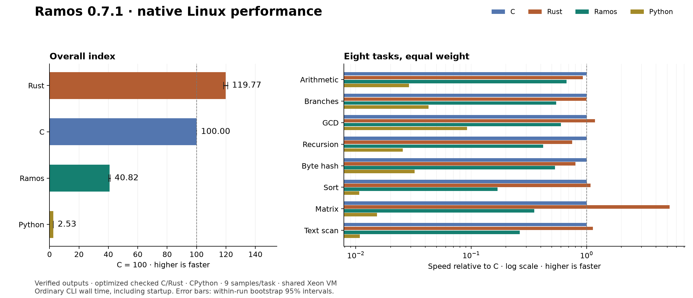

# Ramos 0.7.1 performance: eight-task index

Measured 2026-10-10T06:48:13.205823+00:00 on x86-64 Linux. Higher scores are faster; optimized C = 100.

| Language | Overall execution index | Within-run bootstrap 95% interval |
|---|---:|---:|
| Rust | 119.77 | 118.35–121.16 |
| C | 100.00 | 100.00–100.00 |
| Ramos | 40.82 | 40.28–41.25 |
| Python | 2.53 | 2.48–2.55 |

Across these tasks, Ramos is **16.16× faster than Python**, and takes **2.45× the time of C** and **2.93× the time of Rust** (geometric means of per-task median ratios).

## Per-task execution time

Median wall time in milliseconds for the same work and seed. Includes process creation, loading, argument parsing, allocation, computation and one checked output line.

| Task | Work count | Ramos | C | Rust | Python | Ramos vs Python |
|---|---:|---:|---:|---:|---:|---:|
| Serial integer arithmetic / modulo | 6,640,450 | 46.073 | 30.887 | 33.260 | 1069.989 | 23.22× |
| Data-dependent branches | 2,766,668 | 56.934 | 31.103 | 31.165 | 730.315 | 12.83× |
| Euclidean GCD | 577,528 | 65.537 | 39.234 | 33.116 | 427.032 | 6.52× |
| Runtime-seeded recursive tree | 1,402 | 85.071 | 35.741 | 47.663 | 1398.672 | 16.44× |
| Rolling byte-buffer hash | 7,151,162 | 60.880 | 32.443 | 40.616 | 1004.183 | 16.49× |
| Insertion sort of 128 bytes | 10,991 | 232.404 | 39.367 | 36.405 | 3667.840 | 15.78× |
| 16×16 byte matrix multiplication | 22,503 | 474.846 | 166.925 | 31.891 | 10952.678 | 23.07× |
| Scan 16 KiB ASCII text | 2,242 | 146.948 | 38.741 | 34.066 | 3572.911 | 24.31× |

## Score definition

`Index(language) = 100 × geometric_mean(C_median(task) / language_median(task))`

All eight tasks have equal weight. The suite measures execution of ordinary programs, not patched code, an in-process kernel, compilation throughput or a universal language score. Startup is included in task timings but its separate probe is excluded from the index. The 95% intervals resample the collected timing samples; they do not capture uncertainty from different machines, task selection or operating systems.

## Tasks and correctness

- LCG: serial multiply/add/modulo recurrence with runtime seed.
- Branches: runtime-generated parity and divisibility branches with checksum.
- GCD: Euclidean remainder loops on varying positive inputs.
- Recursion: traverse a depth-12 binary tree with runtime-dependent child values and leaf checksum.
- Byte hash: visit a 4 KiB buffer and update a bounded polynomial hash.
- Insertion sort: refill and sort 128 bytes; checksum weights sorted positions.
- Matrix: multiply two 16×16 byte matrices, writing one input cell per pass, reduce output cells modulo 256, then checksum weighted positions.
- Text scan: classify digits, uppercase ASCII and spaces in 16 KiB; write one byte per pass.

Programs use the same algorithms, sizes, deterministic data and work count in all four languages. Work counts and seeds come from command-line arguments, so answers are not compile-time constants. All 32 task implementations pass independent reference checks at counts 0, 1 and 7 with seeds 1, 17 and 123. Full-size outputs are checked against references on every warmup and timed execution. Native compilers can optimize code normally; recursive calls may be transformed or inlined.

## Measurement method

- 9 timed samples per task/language; randomized language order within each round, sequential execution, two verified warmups.
- Work counts calibrated until both C and Rust took at least about 30 ms in the calibration probes. The same count is then held fixed for all languages.
- This 0.7.1 run reuses the recorded 0.7.0 work counts; it does not recalibrate for the optimizer.
- Pinned to logical CPU 0; Python `perf_counter_ns` wall clock.
- Shared virtual machine; CPU frequency, other tenants and background activity are not controlled. Warm filesystem caches; no Windows performance claim.
- CPython executes source scripts normally, including parsing on every launch. C/Rust/Ramos binaries are built before execution timing.
- GCC: `-O3 -std=c11`, with checked add/subtract/multiply builtins and explicit byte bounds.
- Rust: `-C opt-level=3 -C overflow-checks=yes -C panic=abort`; safe byte indexing/conversion.
- Ramos: default 0.7.1 native backend with local instruction selection optimizations; arithmetic, buffer and call-depth checks retained. Python integers stay within signed 64-bit range for these inputs. C/Rust can eliminate provably redundant checks; Python has no Ramos-style call-depth or byte arena limit. Limits are not reached by the suite.

Raw nanosecond samples, p10/p90, calibration probes, build commands, source hashes and compiler/environment versions are retained in [results.json](results.json).

## Startup probe (excluded from index)

Argument parsing and printing a supplied integer; median over 51 randomized launches.

| Ramos | C | Rust | Python |
|---:|---:|---:|---:|
| 0.394 ms | 0.648 ms | 0.825 ms | 17.638 ms |

## Builds and output size (excluded from index)

Median of three builds per task, including compiler startup and linking/publication. The table shows geometric means across tasks. It is not a general compiler throughput ranking: source sizes differ, and C/Rust use broader optimizers than the local Ramos emitter. Python is run as source and has no native binary in this experiment. Sizes are unstripped compiler outputs with different standard-library/linkage choices.

| Language | Build time | Native binary size | Source size |
|---|---:|---:|---:|
| Ramos | 1.390 ms | 8192 B | 750 B |
| C | 64.837 ms | 16616 B | 1547 B |
| Rust | 169.273 ms | 4506097 B | 925 B |
| Python | — | — | 475 B |

## Next work for Ramos

1. Profile the largest native gaps before adding an optimization pass: Insertion sort of 128 bytes (5.9× C time), Scan 16 KiB ASCII text (3.8× C time), 16×16 byte matrix multiplication (2.8× C time). Version 0.7.1 already reduces buffer-call and stack traffic and specializes constant arithmetic. Further changes need their own measurements.
2. Compare each optimizer change against these exact work counts and compiler hashes, with fresh samples, language correctness tests and both self-hosting proofs. See [the paired 0.7.0/0.7.1 comparison](optimization.md).
3. Measure native Windows separately, then extend the suite with real file-processing programs. Keep syntax small while improving generated code.



## Environment

- CPU: Intel(R) Xeon(R) Platinum 8358 CPU @ 2.60GHz
- Platform: Linux-6.17.0-1020-oracle-x86_64-with-glibc2.39
- Ramos 0.7.1 — compiler written in Ramos; Linux and Windows x64
- gcc (Ubuntu 13.3.0-6ubuntu2~24.04.1) 13.3.0
- rustc 1.98.1 (48a229cea 2026-09-01)
- Python 3.12.3
- Ramos executable SHA-256: `dc4270349d22a391978113121613de849d7076b40a091e29756bca4bb3a672c4`

## Reproduce

From the repository root on x86-64 Linux with GCC, Rust and Python:

```sh
make
python3 benchmarks/run_suite.py
```

Use `--validate-only` for output verification without timings. `--work-counts benchmarks/results.json` reuses the published work counts; `--output-dir` keeps results from another machine separate. Workload sources are in [fixtures/](fixtures/). This is a custom Ramos suite, not a SPEC benchmark. The geometric mean follows [the established ratio aggregation method](https://open.spec.org/cpu2026/docs/runrules.html). See [GCC checked arithmetic](https://gcc.gnu.org/onlinedocs/gcc/Integer-Overflow-Builtins.html) and [Rust code generation settings](https://doc.rust-lang.org/rustc/codegen-options/index.html).

Historical results from a different machine and Ramos 0.2 are preserved in [report-0.2.md](report-0.2.md) and [results-0.2.json](results-0.2.json); they are not directly comparable to this suite.
