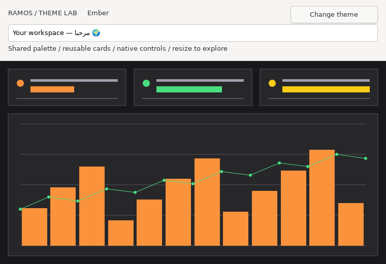

# GUI themes (development source)

The visual direction is readable, deliberate desktop interfaces with shared
spacing, typography and color roles. CSS is an inspiration for reusable style
values. Ramos remains native; Rust itself does not prescribe a visual style.

The first implemented slice is `weave "stdlib/theme.ramos"`, a Ramos-written
palette and canvas-card library built on the existing GUI/drawing APIs.
It has no compiler changes or additional runtime dependencies. These files are
in the development checkout after 0.26.0, not in that release archive.

| Preset | Background and accent |
| --- | --- |
| `theme_paper()` | Pale slate, white surfaces, blue accent |
| `theme_graphite()` | Dark navy, slate surfaces, lavender accent |
| `theme_ember()` | Charcoal surfaces, warm orange accent |

Each returns `GuiTheme` with a name, `background`, `surface`, `border`,
`foreground`, `muted`, `accent`, `success`, `warning`, `spacing` (16) and
`control_height` (32). Colors use `gui_rgb` encoding. The foreground/muted
values are semantic palette roles, not native-widget setters. The public
palette constructors return fresh mutable values; aliases share a value.
`theme_card(canvas, theme, rectangle)` draws a filled surface and border using
the existing checked rectangle and bounded canvas APIs. It consumes two
commands. Existing 1,024-command, coordinate and color limits still apply.

Run the live showcase from the current source checkout:

```sh
./ramos run examples/theme_lab.ramos --gui
```

```powershell
.\ramos.exe run .\examples\theme_lab.ramos --gui
```

It uses actual native windows, buttons and Unicode input, with a retained
dashboard canvas. Change theme cycles Paper → Graphite → Ember; resize reflows
the cards/chart above a 420 × 360 logical application size. Smaller windows may
clip the previous layout because the backend does not yet enforce a minimum
size. The event loop blocks when idle and updates the scene only on a theme
change or usable resize. The chart is illustrative data, not a benchmark.



This capture is from the native Ramos application, not an HTML mockup.

Native labels, inputs, buttons, fonts and title bars retain OS appearance.
Canvas text, image drawing and native control style setters are not implemented.
This slice therefore themes the dashboard surfaces, not the entire window.
It does not introduce CSS parsing, selectors, hover states or a webview.
The showcase uses ordinary `gui_open` rather than opt-in preview scaling; the
reported genuine Windows DPI-transition repaint issue remains a separate gate.

The next UI milestone should apply a small shared theme to native control
backgrounds, readable foregrounds and fonts, followed by canvas text, minimum
sizing and keyboard focus/disabled states. Preserve text selection, keyboard
navigation, Unicode and accessibility while adding styles. Test contrast,
resize, repaint and resource cleanup on both native OSes before calling a
whole-window theme complete. Follow that with a responsive agent GUI: current
HTTP calls are synchronous and need an explicit off-event-thread lifecycle.
An embedded browser can come later through a webview library; finishing the
agent is not a rendering dependency.
